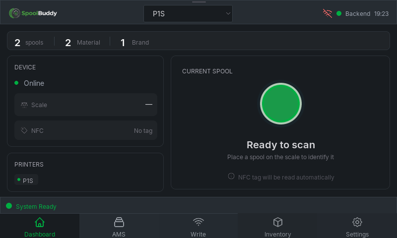
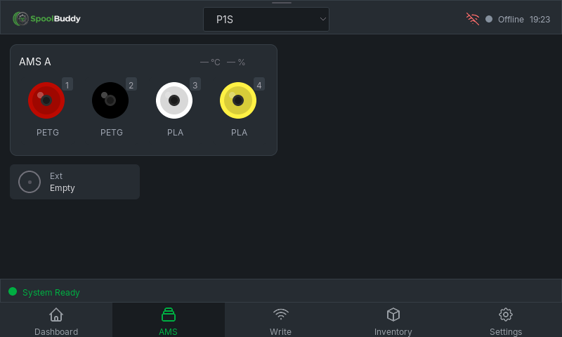
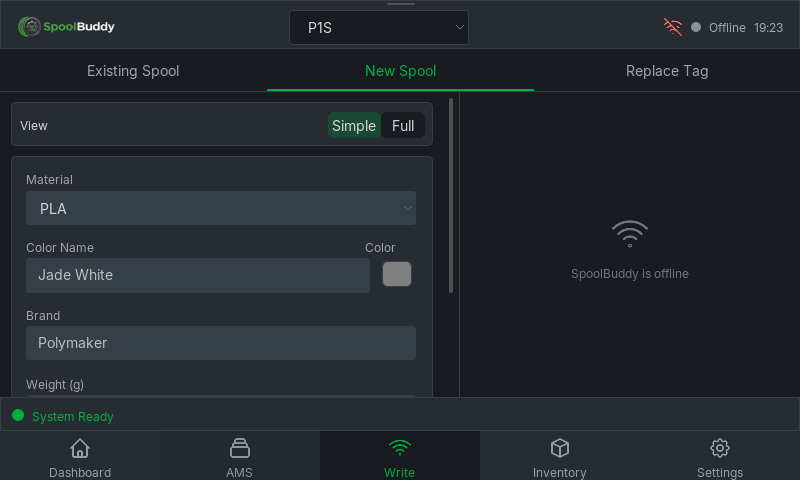
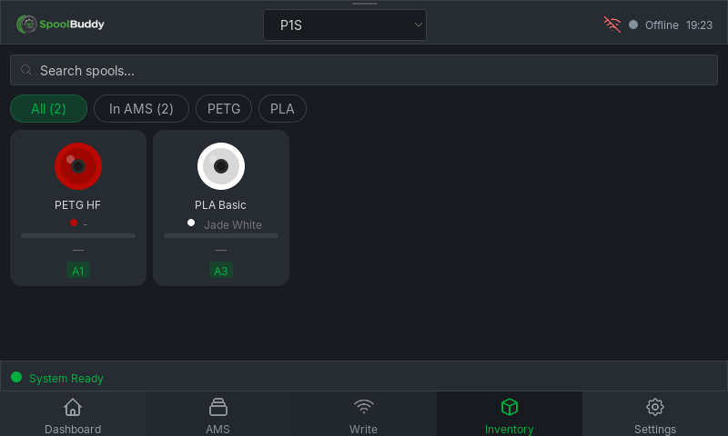
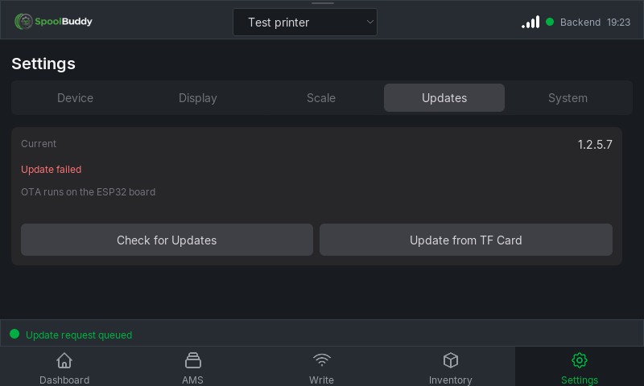
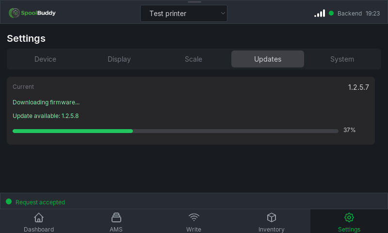

# SpoolBuddy ESP32 · 1.2.5.7

[简体中文](README.md) · English

A port of Bambuddy's integrated SpoolBuddy to **Waveshare ESP32-P4-WIFI6-Touch-LCD-4.3 Rev3.x**: ESP-IDF v6.1, LVGL 9.5.0, 800×480 landscape, Simplified Chinese and English. Original resources, translation keys and APIs are reused; shared implementation and board-specific code are maintained separately.

[Firmware and simulator](https://github.com/tbc0309/spoolbuddy-esp32/releases/tag/v1.2.5.7) · [Complete inline screenshot gallery](docs/SCREENSHOTS.md) · [Port status](docs/en/PORT_STATUS.md) · [Hardware validation](docs/en/HARDWARE_VALIDATION.md)

Display, touch, TF configuration, boot without a card, Wi-Fi/Bambuddy connectivity, BOOT screen sleep/touch wake and TF firmware installation have been tested on hardware. PN5180, NAU7802, a complete HTTPS OTA download/install and intentional failure rollback remain unverified. Exact visual equivalence for every dynamic state is not claimed.

## Installation and configuration

For initial installation, flash the matching Release `.factory.bin` at **0x0**. For subsequent updates, use the application `.bin`, or extract `.tf.zip` and place `spoolbuddy.bin` and `ota.json` in the TF card root. This release targets Rev3.x with 32 MiB Flash and two 12 MiB OTA slots.

Edit the [example configuration](sdcard/spoolbuddy.example.json) with your Wi-Fi credentials and Bambuddy LAN address, then save it as `spoolbuddy.json` in the card root. After a successful backend connection, the board saves it to NVS, retaining the previous valid configuration. Later boots can run without the card; configuration imports compare modification time and content. The onboard C6 supplies networking; P4 connects directly to PN5180 without a Pico.

Omit `language` to follow Bambuddy: Chinese variants map to Simplified Chinese, all other languages to English. An explicit `language` overrides the backend. The default timezone is `CST-8`; optional POSIX `timezone` overrides it. See [configuration](docs/en/CONFIGURATION.md).

Settings → Updates fits on one screen. Checking for an update automatically downloads and installs a newer internal revision; TF installation has a separate entry. OTA from this public repository requires no GitHub credentials. See [OTA](docs/en/OTA.md).

## Build and simulator

In an ESP-IDF v6.1 environment:

```powershell
./tools/build_firmware.ps1 -Board esp32-p4-wifi6-touch-lcd-4.3/rev3 -BuildDirectory build -BuildRevision 6
./simulator/build.ps1 -Integration
./simulator/build/spoolbuddy_sim.exe --config ./simulator/runtime/local-bambuddy.json --connect
```

The Windows simulator runs production LVGL widgets and business logic. It does not emulate P4 instructions or electrical peripherals; its Wi-Fi configuration does not change the computer's network. `./simulator/build.ps1` builds an isolated appearance fixture without contacting a real backend. The Release simulator archive includes an example configuration and launcher.

## Tests and releases

```powershell
$env:PYTHONUTF8='1'
python simulator/test_simulator.py
python simulator/test_realtime.py
python -m pytest tests -q -o asyncio_mode=auto
python tools/check_backend_contract.py --expected-version 1.2.5.7
python tools/update_screenshots.py
```

Use Python 3.12, pytest, Pillow and backend test dependencies. Backend tests also require the pinned `upstream/bambuddy` source and its development environment. They use a disposable database, not your local inventory. After validating the hardware image, run `tools/package_port.py` with the ESP-IDF Python environment.

Compatible with Bambuddy **1.2.5.7**. See [release files](docs/en/RELEASING.md).

## Repository layout

| Directory | Purpose |
|---|---|
| `vendor/spoolbuddy` | Pinned original translation resources and provenance |
| `src/core`, `src/ui` | Shared business logic and original-style LVGL UI |
| `src/platform/esp_idf`, `src/drivers/esp_idf` | Shared SDK integration, PSRAM policy, networking and peripheral drivers |
| `boards/<model>/<revision>` | BSP, pins, display/touch, Flash/PSRAM, partitions and board features |
| `patches` | Opt-in product extensions and separate dependency fixes |
| `simulator`, `tests`, `tools` | Host application, isolated tests, build and release tools |
| `docs`, `docs/screenshots` | Chinese/English documentation and screenshots |

BOOT sleep is enabled by default on this board and preserves ROM download mode; disable it with `-BootSleep $false`. Manual weight, virtual NFC and additional confirmation require explicit `-LocalPatches` and are off by default. The ESP-Hosted RX dependency fix applies automatically. UI, JSON, networking and TLS prefer PSRAM; task stacks, required DMA and low-level drivers retain internal memory.

New boards receive separate `boards` and build directories. Update shared code first, then validate each board without duplicating pages. [Architecture](docs/en/ARCHITECTURE.md) · [Upstream parity](docs/en/UPSTREAM_PARITY.md) · [Installation and wiring](docs/en/INTEGRATION_NOTES.md) · [Third-party notices](THIRD_PARTY.md)

## License

Licensed under [GNU AGPL-3.0-or-later](LICENSE). This is an independent community port derived from [Bambuddy / SpoolBuddy](https://github.com/maziggy/bambuddy). Third-party components, fonts and icons retain their own licenses; see [third-party notices](THIRD_PARTY.md) and [NOTICE](NOTICE).

## Interface preview

These are simulator captures of production LVGL widgets using demonstration data, not photographs of the physical display. The [complete gallery](docs/SCREENSHOTS.md) displays all 47 screenshots directly, including Chinese/English comparisons.

### Home



### AMS



### Write tag



### Inventory



### System


### Updates



### Update progress


