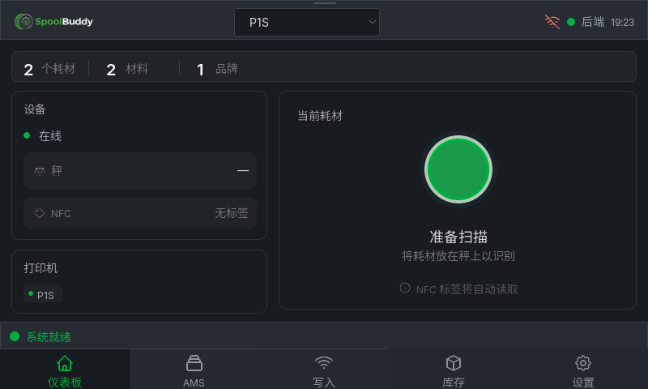
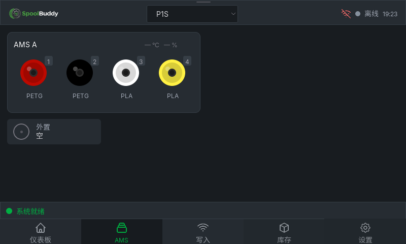
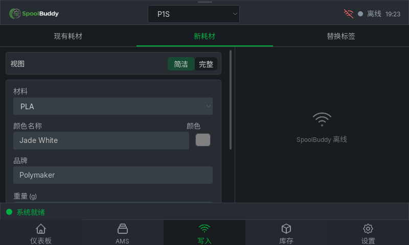
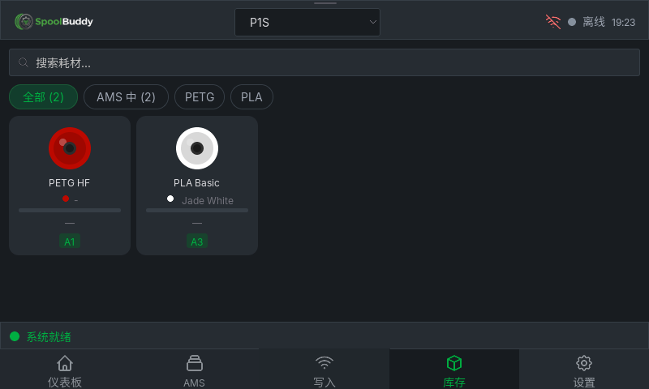
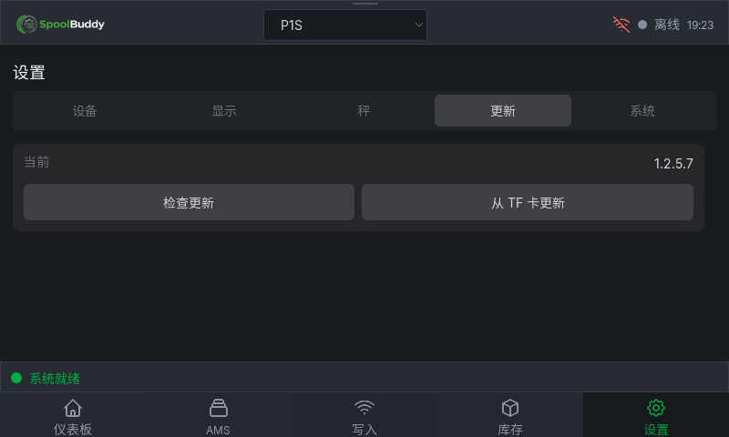
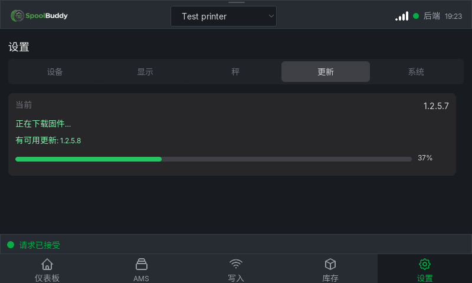

# SpoolBuddy ESP32 · 1.2.5.7

简体中文 · [English](README.en.md)

将 Bambuddy 集成的 SpoolBuddy 移植到 **Waveshare ESP32-P4-WIFI6-Touch-LCD-4.3 Rev3.x**：ESP-IDF v6.1、LVGL 9.5.0、800×480 横屏、简体中文与英语。复用原版资源、i18n 和 API，公共实现与各主板私有内容分开维护。

[固件与模拟器下载](https://github.com/tbc0309/spoolbuddy-esp32/releases/tag/v1.2.5.7) · [截图](docs/SCREENSHOTS.md) · [当前范围](docs/PORT_STATUS.md) · [硬件验收](docs/HARDWARE_VALIDATION.md)

显示、触摸、TF 配置、无卡启动、Wi-Fi/Bambuddy 连接、BOOT 熄屏唤醒和 TF 固件更新已做实板验证。PN5180、NAU7802 外设、HTTPS OTA 完整下载及失败回滚仍待实板验收；不宣称所有动态页面已逐像素等价。

## 安装与配置

首次安装将 Releases 的 `.factory.bin` 从地址 **0x0** 烧录。后续更新使用应用 `.bin`，或解压 `.tf.zip` 将 `spoolbuddy.bin`、`ota.json` 放入 TF 根目录。机型必须匹配 Rev3.x；双 OTA 槽各 12 MiB，Flash 32 MiB。

将 [配置样例](sdcard/spoolbuddy.example.json) 改为实际 Wi-Fi 与 Bambuddy 的局域网地址，保存为 TF 根目录 `spoolbuddy.json`。首次连通后自动保存到板载 NVS，保留上一有效配置，此后可无卡启动；更新配置按日期和内容比较导入。P4 通过板载 C6 联网，直接连接 PN5180，无 Pico 依赖。

默认不写 `language`：跟随 Bambuddy，所有中文变体映射为简体中文，其余语言为英语。若显式配置 `language`，其优先级高于后端。默认时区为 `CST-8`，可用 POSIX `timezone` 覆盖。详见 [配置规则](docs/CONFIGURATION.md)。

“设置 → 更新”单屏显示；点击检查后，发现较新内部修订即自动下载安装，另有独立 TF 更新入口。本公开仓库的 OTA 无需 GitHub 凭据，详见 [OTA](docs/OTA.md)。

## 构建与模拟器

在 ESP-IDF v6.1 环境中：

```powershell
./tools/build_firmware.ps1 -Board esp32-p4-wifi6-touch-lcd-4.3/rev3 -BuildDirectory build -BuildRevision 6
./simulator/build.ps1 -Integration
./simulator/build/spoolbuddy_sim.exe --config ./simulator/runtime/local-bambuddy.json --connect
```

模拟器使用生产 LVGL 控件和业务逻辑；它是 Windows 原生宿主程序，不模拟 P4 指令或外设电气行为。配置中的 Wi-Fi 不改变电脑网络。另可运行外观夹具：`./simulator/build.ps1`，不会访问真实后端。新版发布包内附配置样例。

## 测试与发布

```powershell
$env:PYTHONUTF8='1'
python simulator/test_simulator.py
python simulator/test_realtime.py
python -m pytest tests -q -o asyncio_mode=auto
python tools/check_backend_contract.py --expected-version 1.2.5.7
python tools/update_screenshots.py
```

需要 Python 3.12、pytest、Pillow 与后端测试依赖；后端用例还需要锁定的 `upstream/bambuddy` 源码及其开发依赖。它使用上游受保护的一次性数据库，不修改本机库存。硬件镜像验证后，使用 ESP-IDF Python 运行 `tools/package_port.py` 打包。

当前适配 Bambuddy **1.2.5.7**。[发布文件说明](docs/RELEASING.md)。

## 目录

| 目录 | 内容 |
|---|---|
| `vendor/spoolbuddy` | 原版语言资源快照及来源 |
| `src/core`、`src/ui` | 公共业务和 LVGL 原版界面 |
| `src/platform/esp_idf`、`src/drivers/esp_idf` | 通用 ESP-IDF 适配、PSRAM 策略、网络、外设驱动 |
| `boards/<型号>/<修订版>` | BSP、引脚、显示/触摸、Flash/PSRAM、分区和板级功能 |
| `patches` | 默认关闭的产品扩展及独立依赖修复 |
| `simulator`、`tests`、`tools` | 宿主、隔离测试、构建与发布工具 |
| `docs`、`docs/screenshots` | 中英文文档与界面截图 |

当前主板 BOOT 休眠默认开启且保留 ROM 下载功能；可用 `-BootSleep $false` 关闭。手动重量、虚拟 NFC 和额外确认需显式 `-LocalPatches`，默认关闭。ESP-Hosted RX 兼容修复自动应用，不属于产品扩展开关。PSRAM 优先用于界面、JSON、网络和 TLS，内部内存保留给任务栈、必要 DMA 和底层驱动。

新增机型使用独立的 `boards` 目录及构建目录，先更新公共层再分别复验各板；不复制整套页面。[架构](docs/ARCHITECTURE.md) · [原版差异](docs/UPSTREAM_PARITY.md) · [接线](docs/INTEGRATION_NOTES.md) · [来源和许可](THIRD_PARTY.md)

## 许可证

本项目使用 [GNU AGPL-3.0-or-later](LICENSE)，改编自 [Bambuddy / SpoolBuddy](https://github.com/maziggy/bambuddy)。这是独立的社区移植项目。第三方组件、字体和图标保留各自许可证，详见 [第三方声明](THIRD_PARTY.md) 和 [NOTICE](NOTICE)。

## 界面预览

以下为生产 LVGL 界面的模拟器演示数据截图，非实板拍摄。
[完整截图索引：47 张图片直接展示，中英文对照](docs/SCREENSHOTS.md)。

### 首页



### AMS



### 写入标签



### 库存



### 系统


### 更新



### 更新进度


